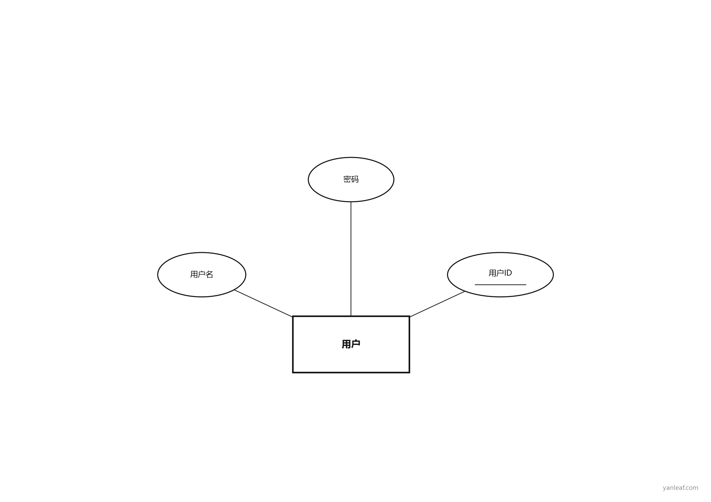

# sql-to-er

SQL → 经典 Chen 风格 ER 图 & Word 三线表设计文档。

作者：[zhouyanye](https://yanleaf.com) · 在线版：https://yanleaf.com/tools/sql-to-er

## 功能

- 解析 MySQL / PostgreSQL / SQL Server / Oracle 常见 `CREATE TABLE`
- Chen 图：经典黑白（有 Graphviz 优先用；否则 matplotlib 黑白回退，**不必强装 Graphviz**）
- 导出 Mermaid、GoJS JSON、Word 三线表
- 解析优先 [yanleaf API](https://yanleaf.com/api/tools/er-diagram/parse)，失败本地回退
- 可作为 Agent Skill 使用（见 `SKILL.md`）

## 环境要求

- **Python 3.9+**（3.10 / 3.11 / 3.12 均可）
- pip 国内镜像源
```bash
pip config set global.index-url https://mirrors.tuna.tsinghua.edu.cn/pypi/web/simple
```
- pip 依赖：

```bash
pip install sqlparse pyyaml python-docx pillow matplotlib graphviz
```

有系统 Graphviz（`dot`）时 PNG 更接近官网布局；没有则自动用 matplotlib 黑白图。SVG/DOT 仍需要 Graphviz。

### 系统 Graphviz（可选）

| 系统 | 安装 |
|------|------|
| Windows | [Graphviz 安装包](https://graphviz.org/download/) 或 `winget install Graphviz.Graphviz`（Chocolatey 需管理员时可用安装包/便携版） |
| macOS | `brew install graphviz` |
| Ubuntu/Debian | `sudo apt install graphviz` |
| Fedora | `sudo dnf install graphviz` |

装不上可忽略，PNG 仍可用。

### 中文显示

matplotlib 会按顺序尝试：`assets/` 内字体 → Noto CJK → 微软雅黑 → 黑体 → 文泉驿 → PingFang。

若中文仍为方框，任选其一：

- Windows：已自带微软雅黑，一般无需处理
- macOS：系统 PingFang 即可
- Linux：`sudo apt install fonts-noto-cjk` 或把 `.ttf/.otf` 放进 `assets/`

## 用法

```bash
# 推荐：图 + Word + Mermaid
python scripts/sql_to_erd.py your.sql --out erd --format all

# 只要 PNG
python scripts/sql_to_erd.py your.sql --format png --out erd

# 只要 Word
python scripts/sql_to_erd.py your.sql --format word --out design

# 强制本地解析、关闭水印
python scripts/sql_to_erd.py your.sql --no-api --no-watermark --format png
```

## 作为 Skill

复制本目录到 Agent skills 路径（如 `.grok/skills/er-diagram/`）。

- 用户给 SQL → 解析并出图
- 用户说「按某某业务画 ER 图」→ 由当前模型设计表结构再渲染（不调用 yanleaf AI 接口）

## 目录

```
er-diagram/
├── SKILL.md
├── README.md
├── LICENSE
├── scripts/
│   ├── sql_to_erd.py
│   ├── render_chen.py      # matplotlib Chen 渲染
│   ├── api_client.py
│   ├── sql_parser.py
│   ├── generate_erd.py
│   ├── export_word.py
│   └── watermark.py
└── assets/
    ├── DejaVuSans.ttf
    └── example-model.yaml
```

## 效果示例



## License

MIT © zhouyanye

DejaVu 字体遵循其原许可。
